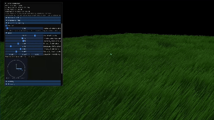
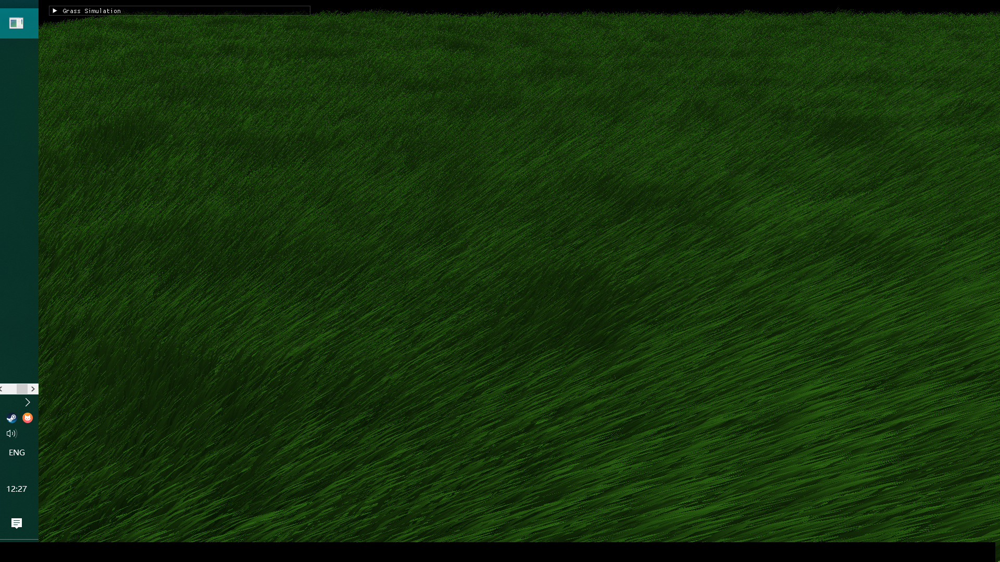
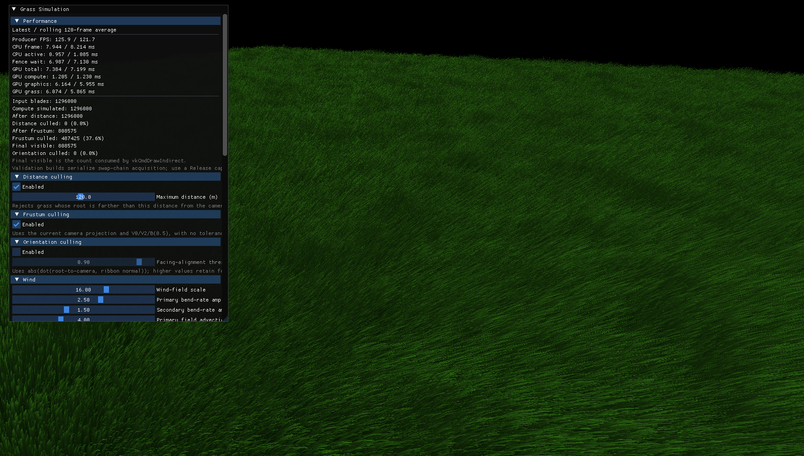
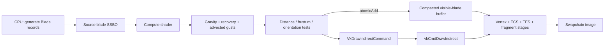
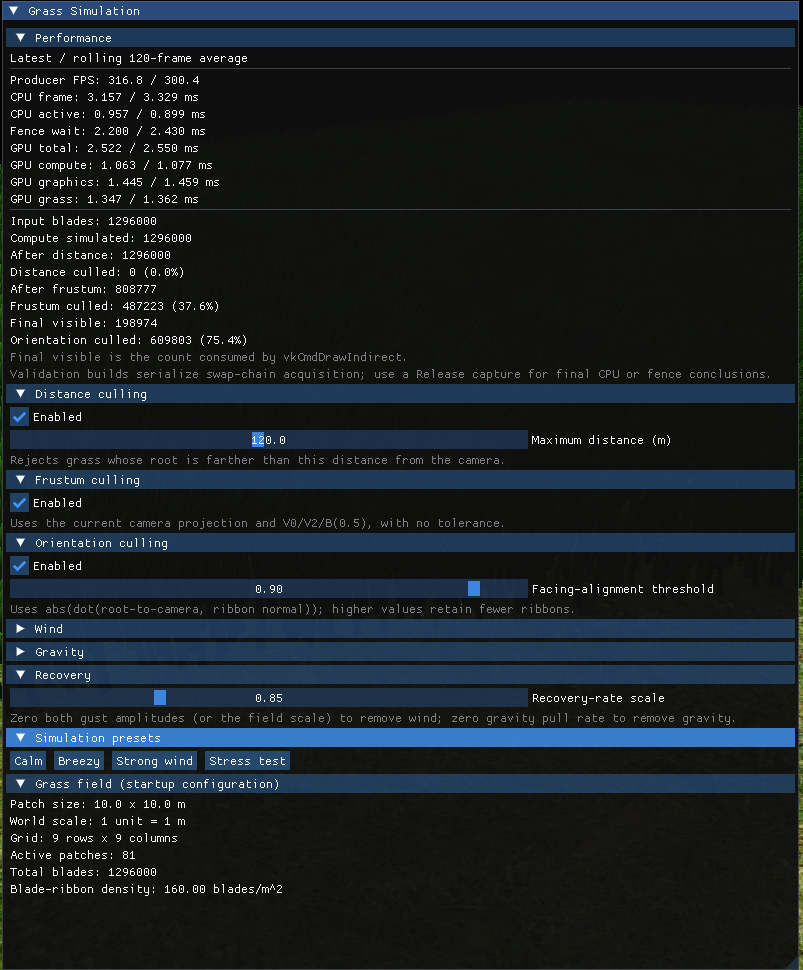
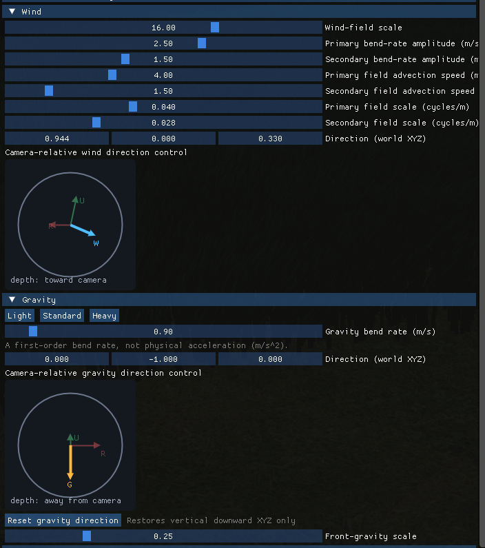
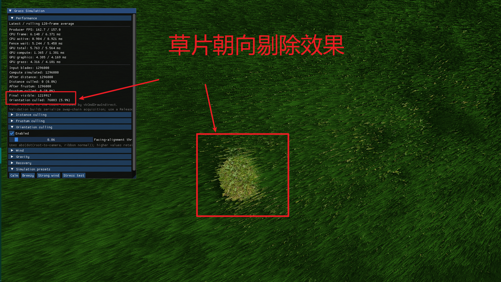
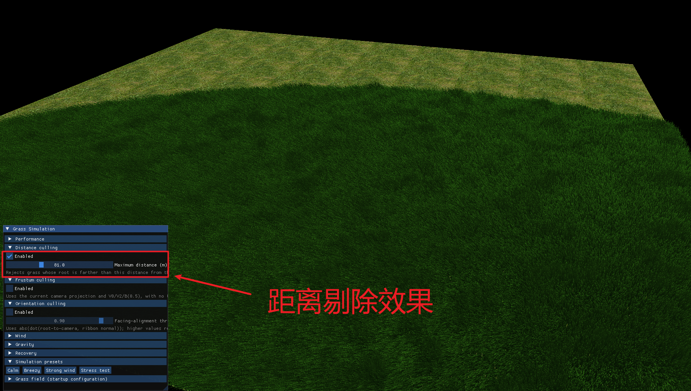
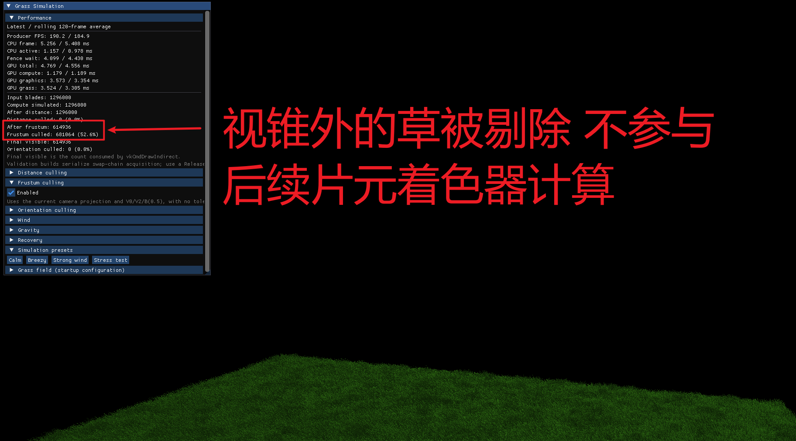

<div align="center">

# Vulkan Grass Rendering

**A GPU-driven, real-time grass renderer built with Vulkan compute, tessellation, and indirect drawing.**

[](https://www.vulkan.org/)


[](https://cis565-fall-2025.github.io/)

[Features](#features) · [Build & Run](#build--run) · [Controls](#controls) · [Architecture](#gpu-pipeline) · [Performance](#performance-methodology)

</div>



## Overview

This project is a Vulkan implementation of **UPenn CIS 565: GPU Programming and Architecture — Project 5**. It renders a dense, world-space grass field as tessellated Bézier ribbons, updates blade deformation in a compute shader, compacts surviving blades on the GPU, and renders them through `vkCmdDrawIndirect`.

The default `grass-field` scene contains **9 × 9 patches**, **3,641 blades per patch**, and **294,921 blades** over a **90 m × 90 m** field. The project uses the convention **1 world unit = 1 metre**.

<p align="center">
  
  
</p>

## Features

| Area | Implementation |
| --- | --- |
| Grass representation | Per-blade quadratic Bézier centerline, expanded in the tessellation-evaluation stage into a tapered double-sided ribbon. |
| Compute simulation | Per-frame update of the physical guide point with gravity, front-gravity bending, recovery, and two independently advected procedural gust fields. Roots remain fixed. |
| GPU visibility | Distance, view-frustum, and orientation tests run in the compute shader. Each surviving blade claims a compacted output slot with `atomicAdd`. |
| Indirect rendering | Compute writes a `VkDrawIndirectCommand`-compatible record; graphics binds the compacted buffer and issues `vkCmdDrawIndirect`. |
| Synchronization | Transfer-to-compute and compute-to-graphics buffer barriers, plus a compute-finished semaphore before indirect-command consumption. |
| Visual treatment | Thin-foliage lighting, per-blade palette variation, root-to-tip colour variation, and view-aware blade shading. |
| Debug UI | Debug builds include a Dear ImGui panel for live culling, wind, gravity, recovery, preset, field-layout, and timing controls. |
| Instrumentation | Rolling 120-frame CPU/GPU timing, plus counts after distance/frustum culling and at final indirect draw consumption. |

## GPU Pipeline



The `Blade` record is shared by CPU code and GLSL `std430` buffers. Its control points and encoded attributes must retain the same layout on both sides of the API boundary.

## Gallery

<details>
<summary><strong>Simulation controls and forces</strong></summary>

<p align="center">
  
</p>

<p align="center">
  
  
</p>

</details>

<details>
<summary><strong>GPU culling stages</strong></summary>

<p align="center">
  
  
</p>

</details>

## Build & Run

### Prerequisites

- Windows 10/11 with a Vulkan-capable GPU and current graphics driver.
- [Vulkan SDK](https://vulkan.lunarg.com/sdk/home) available through `VULKAN_SDK`; it supplies Vulkan headers/libraries and `glslangValidator` for shader compilation.
- CMake 3.20 or newer.
- A C++ toolchain. The commands below use Ninja from an **x64 Visual Studio Developer PowerShell**.

Dependencies used by the project are checked into `external/`: GLFW, GLM, stb, Dear ImGui, and Assimp.

### Configure, build, and launch

```powershell
# From the repository root
cmake -S . -B build -G Ninja -DCMAKE_BUILD_TYPE=Release
cmake --build build
.\bin\vulkan_grass_rendering.exe
```

For validation-layer diagnostics and the interactive ImGui panel, configure a Debug build instead:

```powershell
cmake -S . -B build-debug -G Ninja -DCMAKE_BUILD_TYPE=Debug
cmake --build build-debug
.\bin\vulkan_grass_rendering.exe
```

Build steps compile GLSL to SPIR-V and copy shaders, terrain assets, and simulation presets beside the executable. Run the executable from this deployed layout; do not move it away from its adjacent `shaders/`, `images/`, and `simulation-presets/` directories.

## Controls

| Input | Action |
| --- | --- |
| `W` / `A` / `S` / `D` | Move the free-look camera forward / left / back / right. |
| `Space` / `Ctrl` | Move up / down. |
| `Shift` | Fast camera movement. |
| Left-mouse drag | Look around. |
| Right-mouse drag or scroll wheel | Move forward / backward. |
| Debug ImGui panel | Adjust culling, wind, gravity, recovery, and simulation presets; inspect timings and visibility counters. |

## Performance Methodology

The Debug UI exposes the latest sample and a rolling 120-frame average for producer FPS, CPU frame/active/fence-wait time, and GPU total/compute/graphics/grass timings. It also reports:

- input and simulated blade counts;
- blades surviving distance and frustum culling;
- final visible blades consumed by `vkCmdDrawIndirect`; and
- per-stage culled counts and percentages.

No benchmark figures are claimed here yet: a reproducible comparison needs a fixed camera, preset, resolution, build type, GPU driver, warm-up period, and capture interval. Use a **Release** build for final CPU or fence conclusions, because validation builds deliberately serialize swapchain acquisition.

Recommended experiment matrix:

1. Record the all-culling-disabled baseline.
2. Enable orientation, frustum, and distance culling separately.
3. Enable all three together.
4. Repeat each condition at several blade counts while keeping the scene and camera fixed.

## Project Layout

```text
src/
├── scene/                 # Blade ABI, camera, terrain model, scene creation
├── render/                # Vulkan renderer and timestamp profiler
├── shaders/               # Compute, vertex, tessellation, and fragment shaders
├── simulation/            # Parameters, JSON presets, and wind-field config
├── ui/                    # Dear ImGui Vulkan integration and simulation panel
└── images/                # Runtime terrain texture
docs/                      # Demo GIF, screenshots, and implementation roadmap
external/                  # Checked-in third-party dependencies
```

For a staged implementation guide and data-flow notes, see [docs/project5-roadmap.md](docs/project5-roadmap.md).

## Acknowledgements

- Project framework and assignment: [UPenn CIS 565](https://cis565-fall-2025.github.io/).
- The implementation uses the checked-in GLFW, GLM, stb, Dear ImGui, and Assimp dependencies. Their respective licence files remain with the vendored sources.
- Grass-force formulation and implementation context: `docs/JAHRMANN-2017-RRTG-draft.pdf`.

## Author

**Yijie Yuan (CharlesAcmen)**

- GitHub: [@charlesAcmen](https://github.com/charlesAcmen)
- Repository: [Project5-Vulkan-Grass-Rendering](https://github.com/charlesAcmen/Project5-Vulkan-Grass-Rendering)
